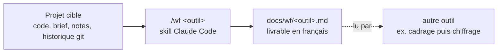

# workflow-tools

Plugin Claude Code : des outils de workflow pour le quotidien d'un chef de projet et développeur freelance web et mobile. Chaque outil est une skill (`/wf-doc-projet`, `/wf-analyse-projet`…) qu'on lance dans le projet cible, et qui y produit un livrable utilisable tel quel.

> **Statut : version 0.1.0, avant la v1.** Les 18 outils ci-dessous sont livrés, chacun avec sa spec validée et ses evals. Le dépôt deviendra public à la v1.

## Fonctionnement



- **Une skill par outil** : instructions, gabarit du livrable et règles d'honnêteté (aucun secret recopié, ce qui n'est pas vérifié est signalé comme tel).
- **Écriture limitée à `docs/wf/`** : aucun outil ne modifie le code du projet, ne l'exécute ni ne crée de commit ([ADR-001](docs/adr/001-conventions-communes-des-outils.md)).
- **Livrables chaînés** : un outil peut lire le livrable d'un autre (le cadrage alimente le chiffrage et les tickets) ; les noms de fichiers et de sections forment un contrat entre specs.

## Outils

| Outil | Rôle | Spec |
| --- | --- | --- |
| `wf-analyse-projet` | Diagnostic de l'état d'un projet existant, avant de le reprendre ou de le chiffrer | [001](docs/specs/001-wf-analyse-projet.md) |
| `wf-doc-projet` | Documentation technique fidèle au code, à remettre à l'équipe ou au client | [002](docs/specs/002-wf-doc-projet.md) |
| `wf-onboarding` | Guide pas à pas d'un nouvel arrivant, jusqu'à sa première contribution | [003](docs/specs/003-wf-onboarding.md) |
| `wf-cadrage-besoin` | Document de cadrage tiré d'un brief client : demandé, exclu, à clarifier | [004](docs/specs/004-wf-cadrage-besoin.md) |
| `wf-chiffrage` | Estimation détaillée et traçable de la charge d'un besoin cadré | [005](docs/specs/005-wf-chiffrage.md) |
| `wf-specs-tickets` | Découpage du besoin cadré en tickets avec critères d'acceptation | [006](docs/specs/006-wf-specs-tickets.md) |
| `wf-compte-rendu` | Compte rendu structuré de réunion, à partir de notes ou d'une transcription | [007](docs/specs/007-wf-compte-rendu.md) |
| `wf-rapport-avancement` | Rapport d'avancement sur une période, pour un client non technique | [008](docs/specs/008-wf-rapport-avancement.md) |
| `wf-release-notes` | Notes de version tirées de l'historique git entre deux références | [009](docs/specs/009-wf-release-notes.md) |
| `wf-revue-securite` | Revue de sécurité du code et des dépendances, constats rattachés à l'OWASP | [010](docs/specs/010-wf-revue-securite.md) |
| `wf-audit-web` | Audit performance, accessibilité, référencement et bonnes pratiques d'un site | [011](docs/specs/011-wf-audit-web.md) |
| `wf-tests-manquants` | Tests à écrire en priorité, avec un squelette pour chacun | [012](docs/specs/012-wf-tests-manquants.md) |
| `wf-montee-version` | Plan ordonné de montée de version : ruptures et fichiers impactés | [013](docs/specs/013-wf-montee-version.md) |
| `wf-recette` | Cahier de recette tiré des specs, résultats saisis à la main | [014](docs/specs/014-wf-recette.md) |
| `wf-publication-store` | Ce qui est prêt et ce qui manque avant une soumission App Store ou Google Play | [015](docs/specs/015-wf-publication-store.md) |
| `wf-passation` | Dossier de passation en fin de mission, pour le repreneur | [016](docs/specs/016-wf-passation.md) |
| `wf-modele-donnees` | Modèle de données, schéma de base et évolutions de schéma | [017](docs/specs/017-wf-modele-donnees.md) |
| `wf-exploitation` | Guide d'exploitation tiré du code : logs, redémarrage, surveillance, incidents | [018](docs/specs/018-wf-exploitation.md) |

## Lancement

```bash
git clone https://github.com/yanis-vroland/workflow-tools.git
cd /chemin/du/projet-cible && claude --plugin-dir /chemin/vers/workflow-tools
# puis, dans Claude Code :
/wf-analyse-projet
```

Prérequis de `wf-cadrage-besoin` pour les sources PDF : [poppler](https://poppler.freedesktop.org/) (`brew install poppler` sur macOS, paquet `poppler-utils` sous Debian ou Ubuntu). La skill en utilise `pdfinfo` (nombre de pages) et `pdftotext` (texte de chaque page), pour citer la page de chaque passage et repérer de façon déterministe un PDF sans texte extractible, comme un document scanné ; sans poppler, les PDF sont écartés.

## Comment c'est vérifié

- **Evals** : chaque outil est couvert par des cas `claude plugin eval` exécutés avec Sonnet sur une fixture fictive, le projet FieldOps (maintenance industrielle), reconstruite à chaque cas. Les correcteurs vérifient les critères d'acceptation de la spec. Détail : [evals/README.md](evals/README.md).
- **Garde-fous** : hooks, pre-commit anti-secrets, vérification des skills et des tags d'evals, testés en local et en CI (`tests/`).
- Aucun taux de réussite n'est publié : les juges LLM sont bruités sur les longs livrables (un cas en échec est relancé une fois en CI), et aucune mesure sur des projets réels n'a encore été faite.

## Limites

- Stacks couvertes : web JavaScript/TypeScript (npm, pnpm, yarn) et Flutter (pub). Les autres sont détectées et signalées « non couvertes ».
- Les livrables sont des brouillons argumentés, à relire avant de les remettre : l'outil cite ses sources mais peut se tromper.
- Rien n'est exécuté : les migrations, squelettes de tests et plans de montée de version restent dans `docs/wf/`, à reprendre à la main.

## Fabrication

Ce dépôt est construit avec [agentic-dev-workflow](https://github.com/yanis-vroland/agentic-dev-workflow) : spec validée avant le code, tests d'abord, revue IA en CI, merge humain.

## Licence

[MIT](LICENSE)
