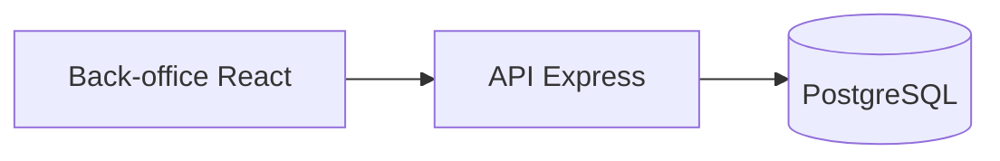

# Documentation du projet FieldOps

> Généré par `wf-doc-projet` le 2026-10-02, commit `be04389`.

## Présentation

FieldOps gère les interventions des techniciens terrain : planification, ordres de travail, suivi et facturation (`README.md`).

Trois rôles d'utilisateur sont définis par la contrainte `CHECK` de la table `users` dans `src/db/schema.sql`, à savoir `admin`, `dispatcher` et `technician`.

## Stack technique

- API : Node.js, Express 4, TypeScript (`package.json`).
- Back-office : React 17, Vite (`package.json`, `vite.config.ts`).
- Base de données : PostgreSQL (`src/db/schema.sql`).

## Architecture



## Installation et lancement

```bash
npm install
npm run serve
```

## Configuration

Variables listées dans `.env.example` : `DATABASE_URL`, `JWT_SECRET`, `PORT`.

## Fonctionnalités

- Suivi des interventions (`src/api/routes/interventions.ts`).
- Ordres de travail (`src/api/routes/workOrders.ts`).

## Structure du code

- `src/api/` : serveur et routes de l'API.
- `src/web/` : back-office.
- `src/domain/` : règles métier.

## Points non déterminés

- Aucun point relevé.
