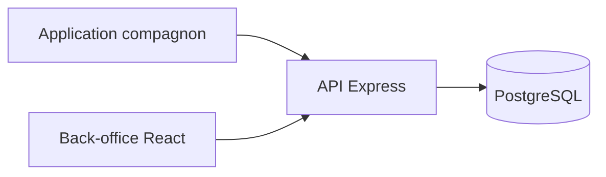

# Documentation du projet FieldOps

> Généré par `wf-doc-projet` le 2026-09-30, commit `5b26289`.

## Présentation

FieldOps gère les interventions des techniciens terrain (`README.md`). Le dépôt est un monorepo : API et back-office web à la racine, application compagnon Flutter dans `mobile/`.

## Stack technique

- Web : Node.js, Express, React (`package.json`).
- Mobile : Flutter (`mobile/pubspec.yaml`).

## Architecture

## Points non déterminés

- Aucun point relevé.

## Autres fichiers

- [Installation et lancement](installation.md)
- [Configuration](configuration.md)
- [Fonctionnalités](fonctionnalites.md)
- [Structure du code](structure.md)
