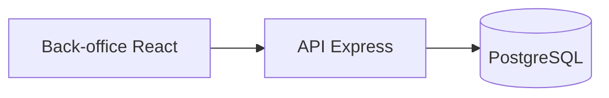

# Documentation du projet FieldOps

> Généré par `wf-doc-projet` le 2026-07-15, commit `0a1b2c3`.

## Présentation

FieldOps gère les interventions des techniciens terrain (`README.md`).

## Stack technique

- Node.js, Express, React (`package.json`).

## Architecture



## Installation et lancement

```bash
npm install
npm run dev
```

## Configuration

Variables listées dans `.env.example` : `DATABASE_URL`, `JWT_SECRET`.

## Fonctionnalités

- Suivi des interventions (`src/api/routes/interventions.ts`).

## Structure du code

- `src/api/` : serveur et routes de l'API.
- `src/web/` : back-office.

## Points non déterminés

- Aucun point relevé.
