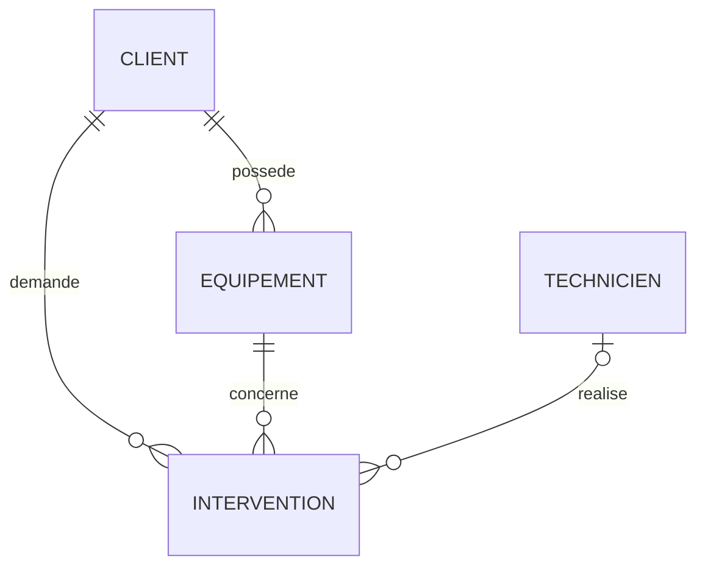

# Modèle de données : outil de gestion des interventions

- Outil : wf-modele-donnees
- Date : 2026-10-01
- Commit analysé : non déterminé (le projet n'est pas un dépôt git)
- Niveau atteint : A (modèle conceptuel)
- Sources lues : brief-fieldops.md, notes-appel.md
- Derniers identifiants attribués : E06, RG06, Q05, D02
- Exécution : aucune ; les fichiers produits n'ont pas été exécutés.

## Synthèse

Modèle conceptuel des interventions de maintenance : clients, équipements, techniciens et interventions. Pour passer au niveau B, il reste à répondre à la question bloquante Q03.

## Modèle conceptuel

### Entités

- E01 Client : société ou particulier chez qui ont lieu les interventions. Source : « Historique des interventions par client et par équipement » (brief-fieldops.md, « Fonctionnalités souhaitées »).
- E02 Technicien : salarié qui réalise les interventions. Source : « Nous employons 40 techniciens répartis sur deux agences » (brief-fieldops.md, « Contexte »).
- E04 Intervention : visite d'un technicien chez un client. Source : « Planification des interventions par les dispatchers » (brief-fieldops.md, « Fonctionnalités souhaitées »).
- E05 Équipement : chaudière ou pompe à chaleur entretenue. Source : « Historique des interventions par client et par équipement » (brief-fieldops.md, « Fonctionnalités souhaitées »).

### Relations

- Client 1 — n Équipement : un client possède des équipements (RG04).
- Client 1 — n Intervention : une intervention est demandée par un client (RG01).
- Équipement 1 — n Intervention : une intervention concerne un équipement (RG05, supposé).
- Technicien 0..1 — n Intervention : une intervention est affectée à au plus un technicien (RG02, supposé, voir Q03).

## Dictionnaire de données

| Entité | Champ | Type | Obligatoire | Exemple | Source |
|---|---|---|---|---|---|
| Client | nom | texte | oui | Société Exemple Chauffage | supposé |
| Client | adresse | texte | oui | 1 rue de l'Exemple, 00000 Villefictive | supposé |
| Technicien | nom | texte | oui | Technicien Fictif | supposé |
| Technicien | zone | texte | oui | Nord | « affectation à un technicien selon sa zone et ses compétences » (brief-fieldops.md, « Fonctionnalités souhaitées ») |
| Technicien | compétences | liste de textes | oui | pompe à chaleur | « selon sa zone et ses compétences » (brief-fieldops.md, « Fonctionnalités souhaitées ») |
| Intervention | date prévue | date et heure | oui | 2026-11-02 09:00 | « Planification des interventions » (brief-fieldops.md, « Fonctionnalités souhaitées ») |
| Intervention | état | énumération | oui | planifiée | « planifiée, en cours, terminée » (brief-fieldops.md, « Fonctionnalités souhaitées ») |
| Intervention | compte rendu | texte | non | Remplacement du joint, essai concluant. | « Saisie du compte rendu par le technicien » (brief-fieldops.md, « Fonctionnalités souhaitées ») |
| Équipement | type | texte | oui | pompe à chaleur | supposé |

## Règles de gestion

- RG01 : une intervention est demandée par un et un seul client. Source : « Informer le client à la fin de chaque intervention » (brief-fieldops.md, « Objectifs »).
- RG02 : une intervention est affectée à au plus un technicien. Source : supposé (voir Q03).
- RG04 : un client possède zéro, un ou plusieurs équipements. Source : « par client et par équipement » (brief-fieldops.md, « Fonctionnalités souhaitées »).
- RG05 : une intervention concerne un et un seul équipement. Source : supposé.

## Questions au client

- Q01 (E01, E05) : « Historique des interventions par client et par équipement » (brief-fieldops.md, « Fonctionnalités souhaitées ») : un client peut-il avoir plusieurs adresses d'intervention, et à quelle adresse un équipement est-il rattaché ? Bloquante : oui.
  Réponse : Oui, un client peut avoir plusieurs sites ; chaque équipement est installé sur un seul site, et une intervention a lieu sur un site.
- Q03 (E02, E04) : « affectation à un technicien selon sa zone et ses compétences » (brief-fieldops.md, « Fonctionnalités souhaitées ») : une intervention peut-elle mobiliser plusieurs techniciens à la fois ? Bloquante : oui.
  Réponse :
- Q04 (E04) : « Tableau de bord mensuel pour la direction » (brief-fieldops.md, « Fonctionnalités souhaitées ») : quels indicateurs doit-il contenir ? Bloquante : non.
  Réponse :
- Q05 (E04) : « Faut-il reprendre l'historique du tableur ? » (notes-appel.md, « À clarifier ») : faut-il reprendre l'historique du tableur, et sous quelle forme ? Bloquante : non.
  Réponse :

## À décider

> **D01 — Retrait d'un technicien**
>
> Contexte : une intervention est affectée à un technicien (RG02) ; les sources ne disent pas ce qu'il advient d'un technicien qui quitte l'entreprise (supposé).
>
> - **Option 1 : suppression définitive.** Conséquence : ses interventions passées perdent leur technicien, ou doivent être supprimées avec lui.
> - **Option 2 : désactivation.** Conséquence : l'historique est conservé ; chaque liste de techniciens doit filtrer les inactifs.
>
> Décision : Option 2, désactivation avec une date de départ ; on garde l'historique.

## Revue du modèle

### Données personnelles

- Technicien.nom : nom d'une personne. Durée de conservation : à préciser.
- Client.adresse : adresse, personnelle si le client est un particulier. Durée de conservation : à préciser.

### Éléments supposés

- Client.nom, Client.adresse, Technicien.nom, Équipement.type, RG02, RG05.

### Nommage incohérent

Aucun élément.

## Points non déterminés

- Durées de conservation des données personnelles : non déterminé.
