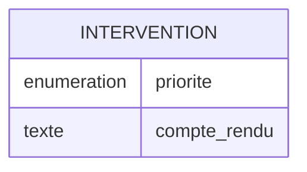

# Modèle de données : évolution des interventions

- Outil : wf-modele-donnees
- Date : 2026-10-10
- Commit analysé : 5b26289
- Niveau atteint : C (évolution)
- Sources lues : ../demandes/evolution-interventions.md
- Derniers identifiants attribués : E01, RG02, Q00, D01
- Exécution : aucune ; les fichiers produits n'ont pas été exécutés.

## Synthèse

Évolution de la table des interventions : priorité obligatoire, renommage du compte rendu, retrait du taux horaire en attente de la décision D01.

## Modèle conceptuel

### Entités

- E01 Intervention : visite planifiée chez un client. Source : `src/db/schema.sql` (table `interventions`).

### Relations

Aucun élément.

## Dictionnaire de données

| Entité | Champ | Type | Obligatoire | Exemple | Source |
|---|---|---|---|---|---|
| Intervention | priorité | énumération (normale, urgente) | oui | normale | « Chaque intervention doit désormais avoir une priorité obligatoire » (evolution-interventions.md, « Changements demandés ») |
| Intervention | compte rendu (`visit_report`) | texte | non | Remplacement du joint. | « s'appellera `visit_report` » (evolution-interventions.md, « Changements demandés ») |

## Règles de gestion

- RG01 : la priorité vaut normale ou urgente ; les interventions existantes sont de priorité normale. Source : « Les interventions déjà enregistrées sont toutes de priorité normale » (evolution-interventions.md, « Changements demandés »).
- RG02 : aucune donnée existante n'est perdue lors de la mise à jour. Source : « Aucune donnée existante ne doit être perdue » (evolution-interventions.md, « Contraintes »).

## Questions au client

Aucun élément.

## À décider

> **D01 — Suppression du taux horaire**
>
> Contexte : « Le taux horaire des interventions (`hourly_rate`) ne nous sert plus » (evolution-interventions.md, « Changements demandés ») ; la colonne `interventions.hourly_rate` est lue par `src/api/routes/workOrders.ts`.
>
> - **Option 1 : supprimer la colonne.** Conséquence : les taux déjà saisis sont perdus ; le calcul de facture de `workOrders.ts` doit être retiré.
> - **Option 2 : conserver la colonne sans l'utiliser.** Conséquence : aucune perte ; une colonne morte reste dans le schéma.
>
> Décision : Option 1, supprimer la colonne hourly_rate ; les taux passés ne sont plus utiles.

## Revue du modèle

### Données personnelles

Aucun élément.

### Éléments supposés

Aucun élément.

### Nommage incohérent

Aucun élément.

## Évolution

| Schéma | Base ou ORM | Outil de migration |
|---|---|---|
| `src/db/schema.sql` | PostgreSQL, SQL écrit à la main | aucun |
| `mobile/lib/db/local_db.dart` | sqflite | montée de version (`version: 1`, pas d'`onUpgrade`) |

### Différences

- Colonne ajoutée : `interventions.priority`. Source : « priorité obligatoire » (evolution-interventions.md, « Changements demandés »).
- Colonne renommée : `interventions.report` en `visit_report`, serveur et base locale. Source : « s'appellera `visit_report` » (evolution-interventions.md, « Changements demandés »).
- Colonne supprimée : `interventions.hourly_rate`, en attente de D01.

## Points non déterminés

Aucun élément.
