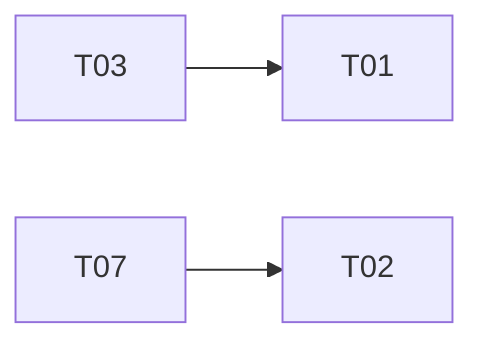

# Tickets de FieldOps

Outil : wf-specs-tickets · Date : 2025-10-28 · Commit : f9f97a3
Fichiers d'entrée : cadrage-besoin.md

## Synthèse

Cinq tickets couvrent les besoins cadrés. Il est recommandé, sans que ce soit obligatoire, de citer l'identifiant du ticket dans le nom de la branche ou dans le message du commit qui le réalise (ex. `feat/T03-facture`), pour permettre le suivi par `wf-rapport-avancement`.

## Ordre de réalisation

1. T03
2. T07
3. T01
4. T02
5. T10

## Tickets

### T01 : Export PDF du compte rendu d'intervention

#### Récit utilisateur

En tant que dispatcher, je veux exporter en PDF le compte rendu d'une intervention terminée, afin de l'envoyer au client.

#### Contexte

Le client reçoit aujourd'hui le compte rendu par e-mail, sans mise en page.

#### Critères d'acceptation

- CA1 : Étant donné une intervention terminée, quand je clique sur « Exporter en PDF », alors un PDF du compte rendu est téléchargé en moins de 5 secondes.

#### Hors périmètre

Envoi automatique du PDF.

#### Dépendances

T03

#### Besoins couverts

B04

#### Estimation

non estimé

#### Fichiers concernés

`src/domain/pdfExport.ts` (à créer)

#### Points à clarifier

aucun

### T02 : Notification du client à la planification

#### Récit utilisateur

En tant que client, je veux être prévenu quand une intervention est planifiée chez moi, afin d'être présent.

#### Contexte

Le canal de notification reste à choisir.

#### Critères d'acceptation

- CA1 : Étant donné une intervention planifiée, quand le dispatcher l'enregistre, alors le client reçoit une notification dans les 10 minutes.

#### Hors périmètre

Rappel la veille de l'intervention.

#### Dépendances

T07

#### Besoins couverts

B05

#### Estimation

non estimé

#### Fichiers concernés

`src/services/mailer.ts`

#### Points à clarifier

Q02

### T03 : Facture détaillée d'un ordre de travail

#### Récit utilisateur

En tant que comptable, je veux une facture détaillée par ordre de travail, afin de facturer le client sans ressaisie.

#### Contexte

Les frais de déplacement et la TVA sont calculés à la main.

#### Critères d'acceptation

- CA1 : Étant donné un ordre de travail clos, quand je génère sa facture, alors elle détaille les lignes, les frais de déplacement et la TVA.

#### Hors périmètre

Paiement en ligne.

#### Dépendances

aucune

#### Besoins couverts

B02

#### Estimation

non estimé

#### Fichiers concernés

`src/domain/invoice.ts`

#### Points à clarifier

aucun

### T07 : Suggestion du technicien disponible

#### Récit utilisateur

En tant que dispatcher, je veux que l'outil me suggère un technicien disponible, afin de planifier une intervention en moins de 2 minutes.

#### Contexte

La planification se fait aujourd'hui sur un tableur partagé.

#### Critères d'acceptation

- CA1 : Étant donné une intervention à planifier, quand j'ouvre la planification, alors au moins un technicien disponible sur le créneau est proposé.

#### Hors périmètre

Optimisation des trajets.

#### Dépendances

aucune

#### Besoins couverts

B03

#### Estimation

non estimé

#### Fichiers concernés

`src/domain/scheduling.ts` (à créer)

#### Points à clarifier

aucun

### T10 : Reprise de l'historique du tableur

#### Récit utilisateur

En tant que dispatcher, je veux retrouver dans l'outil les interventions passées du tableur, afin de consulter l'historique d'un client.

#### Contexte

Le tableur contient trois ans d'interventions.

#### Critères d'acceptation

- CA1 : Étant donné le tableur exporté en CSV, quand la reprise est lancée, alors chaque ligne valide devient une intervention close.

#### Hors périmètre

Reprise des factures.

#### Dépendances

aucune

#### Besoins couverts

B06

#### Estimation

non estimé

#### Fichiers concernés

non déterminé

#### Points à clarifier

Q04

## Besoins non couverts

- B01 : couvert par l'existant (suivi des interventions).

## Points non déterminés

- Aucun.
