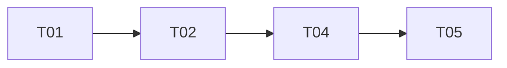

# Tickets : outil de gestion des interventions

- Outil : wf-specs-tickets
- Date : 2026-10-10
- Commit analysé : non déterminé (le projet n'est pas un dépôt git)
- Fichiers d'entrée : cadrage-besoin.md
- Derniers identifiants attribués : T06

## Synthèse

Quatre tickets couvrent les besoins B01 à B04 du cadrage. Il est recommandé de citer l'identifiant du ticket dans le nom de la branche ou dans le message du commit qui le réalise (ex. `feat/T03-export-pdf`), pour permettre le suivi par `wf-rapport-avancement`.

## Ordre de réalisation

1. T01
2. T02
3. T04
4. T05

## Tickets

### T01 : Planifier et affecter les interventions

#### Récit utilisateur

En tant que dispatcher, je veux planifier une intervention et l'affecter à un technicien de la bonne zone et compétent, afin de tenir le planning sans tableur.

#### Contexte

Le planning est aujourd'hui tenu dans un tableur partagé (cadrage-besoin.md, « Contexte et objectifs »).

#### Critères d'acceptation

- CA1 : Étant donné une intervention à planifier, quand le dispatcher choisit une date et un technicien, alors l'intervention apparaît dans le planning de ce technicien à cette date.
- CA2 : Étant donné un technicien dont la zone ne correspond pas à l'adresse de l'intervention, quand le dispatcher l'affecte, alors un avertissement indique la zone du technicien et celle de l'intervention.

Dernier critère attribué : CA2.

#### Hors périmètre

Facturation.

#### Dépendances

Aucune.

#### Besoins couverts

B01

#### Estimation

non estimé

#### Fichiers concernés

non applicable (projet sans code)

#### Points à clarifier

Q01, Q02

### T02 : Suivre l'état d'une intervention

#### Récit utilisateur

En tant que dispatcher, je veux voir l'état de chaque intervention, afin de savoir lesquelles sont terminées.

#### Contexte

États demandés : planifiée, en cours, terminée (cadrage-besoin.md, B02).

#### Critères d'acceptation

- CA1 : Étant donné une intervention planifiée, quand le technicien la démarre, alors son état passe à « en cours ».
- CA3 : Étant donné une intervention en cours, quand le technicien la clôt, alors son état passe à « terminée ».

Dernier critère attribué : CA3.

#### Hors périmètre

Aucun.

#### Dépendances

T01

#### Besoins couverts

B02

#### Estimation

non estimé

#### Fichiers concernés

non applicable (projet sans code)

#### Points à clarifier

aucun

### T04 : Saisir le compte rendu sur mobile, hors connexion

#### Récit utilisateur

En tant que technicien, je veux saisir mon compte rendu sur mon téléphone, même sans réseau, afin de ne plus le ressaisir au bureau.

#### Contexte

Application mobile Android hors connexion (cadrage-besoin.md, réponse saisie à la question Q03).

#### Critères d'acceptation

- CA1 : Étant donné un téléphone sans réseau, quand le technicien enregistre un compte rendu, alors il est conservé sur le téléphone et envoyé au retour du réseau.

Dernier critère attribué : CA1.

#### Hors périmètre

Aucun.

#### Dépendances

T02

#### Besoins couverts

B03

#### Estimation

non estimé

#### Fichiers concernés

non applicable (projet sans code)

#### Points à clarifier

Q04

### T05 : Envoyer le compte rendu au client

#### Récit utilisateur

En tant que dispatcher, je veux que le client reçoive le compte rendu à la fin de l'intervention, afin qu'il soit informé sans action de ma part.

#### Contexte

Envoi automatique par e-mail (cadrage-besoin.md, B04).

#### Critères d'acceptation

- CA1 : Étant donné une intervention qui passe à l'état « terminée », quand son compte rendu est enregistré, alors un e-mail contenant le compte rendu en pièce jointe est envoyé au client.

Dernier critère attribué : CA1.

#### Hors périmètre

Aucun.

#### Dépendances

T04

#### Besoins couverts

B04

#### Estimation

non estimé

#### Fichiers concernés

non applicable (projet sans code)

#### Points à clarifier

aucun

## Besoins non couverts

Aucun élément.

## Points non déterminés

Aucun élément.
