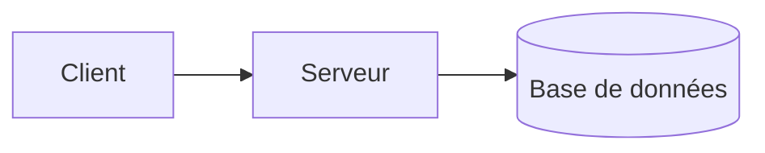

# wf-doc-projet : documentation d'un projet existant

Tu documentes le projet du répertoire courant (sa racine) pour l'équipe ou le client. Le livrable **décrit**, il ne juge pas. Il est rédigé en français.

## Règles absolues

- **Écriture** : tu n'écris que dans `docs/wf/` du projet (créé s'il n'existe pas), avec l'outil Write, un appel par fichier du livrable. Aucun autre fichier n'est créé ni modifié : ni README, ni documentation existante, ni fichier temporaire. Tu n'exécutes pas le projet, ni son installation, ni ses tests, et tu ne crées ni branche ni commit.
- **Secrets** : ne lis aucun fichier d'environnement `.env*`, sauf `.env.example` : ni avec Read, ni avec `cat`, `grep`, `head`, `source`… Ne lance jamais de recherche sur la racine entière : cible les dossiers de code (`src/`, `lib/`, `app/`, `mobile/lib/`…) ou des fichiers précis, pour qu'aucun `.env*` ne soit parcouru.
- **Honnêteté** : toute affirmation s'appuie sur un fichier lu, dont le chemin est cité entre accents graves. Ce qui n'a pas pu être établi est écrit « non déterminé », jamais deviné. Aucune commande, variable ou fonctionnalité n'est inventée.
- **Aucune valeur** de variable d'environnement, ni valeur par défaut tirée du code, ni URL de connexion, ni mot de passe. Pas d'adresse e-mail de contributeur ni d'aucune autre adresse e-mail.
- **Aucun jugement de qualité** (cela relève de `wf-analyse-projet`) : pas de dette, de risque, de faille, de vulnérabilité, de version obsolète ou en fin de support, de « à corriger », « à améliorer », « mauvaise pratique », « non sécurisé », ni de note ou de score (« 7/10 »). Ces mots sont proscrits du livrable, même en passant. Une version se cite telle que déclarée, sans commentaire.
- Les dates s'écrivent au format `AAAA-MM-JJ`.

## Étape 1 : vérifier qu'il y a du code

Liste les fichiers du projet :

```bash
git ls-files --cached --others --exclude-standard 2>/dev/null || find . -type f -not -path './.git/*' -not -path '*/node_modules/*'
```

Si le répertoire est vide, ou s'il ne contient ni fichier de code source (`.ts`, `.tsx`, `.js`, `.jsx`, `.vue`, `.dart`, `.py`, `.php`, `.rb`, `.java`, `.kt`, `.swift`, `.go`, `.rs`, `.cs`, `.sql`…) ni manifeste (`package.json`, `pubspec.yaml`, `composer.json`, `pyproject.toml`, `go.mod`…), **arrête-toi sans rien écrire** (pas de `docs/wf/`) et termine par l'un de ces messages :

- répertoire vide : « Le répertoire est vide : aucun code source à documenter. Aucune documentation n'a été produite. »
- documents seuls : « Aucun code source dans ce répertoire (seulement des documents : <exemples de fichiers>). Aucune documentation n'a été produite. »

## Étape 2 : en-tête

Avant toute écriture, relève :

- la date : `date +%Y-%m-%d` ;
- le commit : `git rev-parse --short HEAD` ; hors dépôt git, « commit non déterminé (pas de dépôt git) » ;
- l'état : `git status --porcelain -- . ':(exclude)docs/wf'`. Sortie non vide : ajoute « modifications non commitées » après le commit. Sortie vide : n'écris cette mention nulle part dans le livrable.

## Étape 3 : choisir le format

- **Monorepo** : plusieurs applications dans des dossiers distincts, chacune avec son manifeste (ex. `package.json` à la racine et `mobile/pubspec.yaml`), ou un manifeste d'espaces de travail (`workspaces` de `package.json`, `pnpm-workspace.yaml`, `melos.yaml`, `turbo.json`, `nx.json`). Ignore `node_modules/`, les dossiers de build et `docs/wf/`.
- Monorepo → **format dossier** `docs/wf/doc-projet/`.
- Sinon → **fichier unique** `docs/wf/doc-projet.md`, d'au plus 500 lignes, toutes lignes comprises (en-tête et lignes vides, comme `wc -l`). Si la documentation ne tient pas en 500 lignes, passe au format dossier.

## Étape 4 : relire le livrable existant

Lis `docs/wf/doc-projet.md` ou les fichiers de `docs/wf/doc-projet/` s'ils existent. Le livrable est **mis à jour, jamais dupliqué** :

- vérifie chaque affirmation dans les fichiers qu'elle cite ; si elle est encore exacte, **recopie-la mot pour mot** ;
- corrige ce qui a changé, complète ce qui manque, retire ce qui n'existe plus ;
- remplace l'en-tête (nouvelle date, nouveau commit).

## Étape 5 : collecter, section par section

Lis les manifestes, fichiers de verrouillage, README, `Makefile`, `Dockerfile`, `docker-compose.yml`, `.env.example`, configurations (`tsconfig.json`, `vite.config.*`, `analysis_options.yaml`…) et le code utile. Dans un monorepo, traite chaque application séparément.

- **Présentation** : rôle du projet et ses utilisateurs (README, `description` du manifeste, code). Dans un monorepo, liste les applications et leur dossier.
- **Stack technique** : langages, frameworks, base de données, outils, avec les versions déclarées et le fichier source.
- **Architecture** : composants principaux (applications, API, base de données, services tiers) et leurs relations, tirés du code (clients HTTP, connexions, appels). Un schéma Mermaid est obligatoire.
- **Installation et lancement** : commandes réelles, recopiées avec toute valeur de variable remplacée par un paramètre `<…>` :
  - scripts du manifeste (`scripts` de `package.json`, cibles du `Makefile`) : lancement, données initiales, tests, build… sous la forme exacte de l'outil (`npm run <script>`, `npm test`) ;
  - la commande d'installation des dépendances de l'outil désigné par le manifeste et le fichier de verrouillage (`npm install`, `pnpm install`, `yarn install`, `flutter pub get`) ;
  - les commandes d'un README seulement si elles existent bien dans le projet (script, cible ou fichier présent).
  - Sans manifeste, `Makefile` ni commande vérifiable : écris « Aucune commande d'installation ou de lancement identifiée dans le projet : non déterminé », cite les fichiers cherchés, et **n'écris aucune commande**, même à titre d'exemple.
- **Configuration** : **tous** les noms de variables de `.env.example`, plus ceux lus dans le code (`process.env.X`, `import.meta.env.X`, `String.fromEnvironment('X')`, `os.environ`…), avec le fichier qui les utilise et leur rôle s'il est établi. Jamais de valeur.
- **Fonctionnalités** : ce que fait le projet, tiré des routes, pages, écrans et modules métier, avec les fichiers cités. Pas de référence exhaustive d'API.
- **Structure du code** : arborescence des dossiers principaux et rôle de chacun.
- **Points non déterminés** :
  - chaque écart entre un README et le code, décrit factuellement en citant les deux fichiers, sans modifier le README. Exemple : « `README.md` indique `make run`, mais le projet ne contient pas de `Makefile`. » ;
  - tout ce qui n'a pas pu être établi (dont l'absence de commande de lancement) ;
  - sinon : « Aucun point relevé. »

## Étape 6 : écrire le livrable

### Fichier unique : `docs/wf/doc-projet.md`

````markdown
# Documentation du projet <nom>

> Généré par `wf-doc-projet` le <AAAA-MM-JJ>, commit `<hash>`[, modifications non commitées].

## Présentation
## Stack technique
## Architecture



## Installation et lancement
## Configuration
## Fonctionnalités
## Structure du code
## Points non déterminés
````

### Format dossier : `docs/wf/doc-projet/`

- `index.md` : titre et en-tête comme ci-dessus, puis `## Présentation`, `## Stack technique`, `## Architecture` (schéma Mermaid de toutes les applications), `## Points non déterminés`, et enfin `## Autres fichiers` avec les liens relatifs `[Installation et lancement](installation.md)`, `[Configuration](configuration.md)`, `[Fonctionnalités](fonctionnalites.md)`, `[Structure du code](structure.md)`.
- `installation.md` (`# Installation et lancement`), `configuration.md` (`# Configuration`), `fonctionnalites.md` (`# Fonctionnalités`), `structure.md` (`# Structure du code`).
- Dans un monorepo, chacun de ces quatre fichiers contient une sous-section `##` par application, nommée par son rôle, sa techno et son dossier, ex. `## Application web : site public Next.js (web/)`, `## Application mobile Flutter (app/)`.

### Mise à jour

Si un livrable existe déjà, garde mot pour mot ce qui reste exact, corrige ce qui ne l'est plus, et décris uniquement l'état actuel : aucune trace de l'ancienne version (pas de « la version précédente citait… », pas de journal des modifications).

### Changement de format

Si l'ancien livrable est dans l'autre format, n'écris jamais à son emplacement. Écris le nouveau format, puis supprime l'ancien par une commande shell, pour que les deux ne coexistent pas :

- ancien fichier unique : `rm docs/wf/doc-projet.md` ;
- ancien dossier : `rm -r docs/wf/doc-projet`.

## Étape 7 : vérifier

- Fichier unique : `wc -l docs/wf/doc-projet.md` donne au plus 500 ; sinon, passe au format dossier (étape 6).
- Cherche dans le livrable le vocabulaire proscrit et les valeurs :

  ```bash
  grep -rniE 'dette|risqu|vulnérab|faille|obsolète|fin de support|à corriger|à améliorer|mauvaise pratique|non sécuris|[0-9] */ *(10|20|100)\b|[A-Z_]{3,}=[^ <]' docs/wf/
  ```

  Réécris tout passage trouvé (avec Write) ; une valeur indispensable dans une commande devient un paramètre `<…>`.
- Les huit sections sont présentes, dans l'ordre, et l'en-tête figure dans les premières lignes.

Termine par un message court : chemin du livrable, format retenu et pourquoi, nombre de lignes, et points non déterminés relevés.
