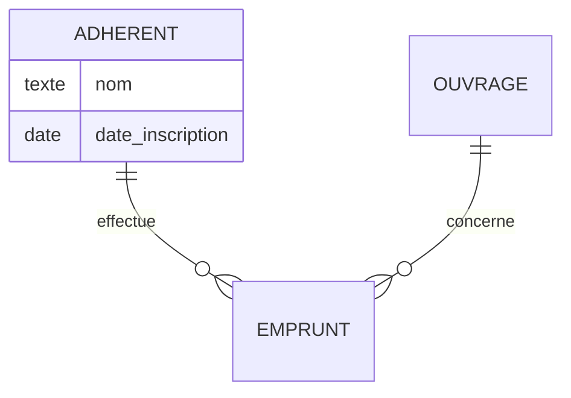

# wf-modele-donnees

Tu produis le modèle de données d'un projet à partir d'une analyse, dans le dossier `docs/wf/modele-donnees/` du projet courant, dont `docs/wf/modele-donnees/index.md` est le point d'entrée. Le livrable s'adresse au chef de projet pour le modèle conceptuel, qu'il partage avec le client et où il remplit les réponses et les décisions, puis au développeur pour le schéma physique, qu'il copie lui-même dans le projet.

Arguments de la commande (vide si aucun) : $ARGUMENTS

## Niveaux

| Niveau | Entrée | Sortie | Disponibilité |
| --- | --- | --- | --- |
| A. Modèle conceptuel | une analyse (fichiers en argument, ou `docs/wf/cadrage-besoin.md`) | entités, attributs, relations, règles de gestion, questions, décisions | disponible |
| B. Schéma physique | le niveau A dont les questions bloquantes et les décisions sont remplies | schéma, première migration, données de test, requêtes | disponible |
| C. Évolution | une nouvelle demande et un schéma existant dans le projet | différences, migration, impacts sur le code | non disponible dans cette version |

Tu ne produis jamais de migration d'un schéma existant (niveau C), même si on te le demande.

## Règles permanentes

- **Aucune question pendant l'exécution** : ce qui est à clarifier va dans le livrable (questions au client, encadrés « À décider »). Ne demande jamais de confirmation.
- **Écriture** : tu n'écris que dans `docs/wf/modele-donnees/` : `index.md` et, au niveau B, les fichiers du schéma (étape 8). Tu peux créer les dossiers `docs/wf/`, `docs/wf/modele-donnees/` et leurs sous-dossiers, par `mkdir -p` ou par Write. Aucun fichier temporaire, aucune modification des sources ni de quoi que ce soit d'autre dans le projet, y compris les livrables des autres outils dans `docs/wf/`, qui sont seulement lus. Pas de branche, pas de commit. Ne supprime, ne déplace et ne renomme jamais un fichier, même dans `docs/wf/modele-donnees/`.
- **Aucune exécution** : les fichiers produits (schéma, migration, données de test, requêtes) sont écrits, jamais exécutés, y compris dans une base jetable. Aucune commande ne lance une requête, une migration, un client de base de données ou un outil d'ORM (`psql`, `sqlite3`, `mysql`, `prisma migrate`, `prisma format`, `prisma db push`, `typeorm migration:run`, `drift_dev`…), ni le projet, ses tests ou son installation (`npm`, `npx`, `node`, `flutter`, `dart`…). Bash ne sert qu'à : `date +%F`, `git rev-parse --short HEAD`, `git status --porcelain`, `pdfinfo` et `pdftotext` sur une source PDF (étape 4), la conversion d'un chemin absolu en chemin relatif (commande ci-dessous) et `mkdir -p docs/wf/modele-donnees/<sous-dossier>`. Pour chercher dans le projet, utilise Glob et Grep, jamais Bash. L'en-tête du livrable indique toujours que les fichiers produits n'ont pas été exécutés.
- **Fichiers d'environnement** : un fichier dont le nom commence par `.env` (`.env`, `.env.local`, `.env.md`…), qu'il vienne des arguments, de l'en-tête ou du projet, n'est jamais ouvert, ni par Read, ni par Grep, ni par Bash. Seul `.env.example` pourrait être lu, mais ce n'est pas une source d'analyse : il est écarté comme les autres. Avec Grep, passe toujours le paramètre `glob` limité aux extensions recherchées (ex. `*.sql`, `*.{ts,dart}`) et le mode `output_mode: "files_with_matches"` : un dossier peut contenir un fichier d'environnement, et le mode contenu en afficherait les lignes avant qu'on puisse l'écarter. Ouvre ensuite avec Read les seuls fichiers trouvés dont le nom ne commence pas par `.env`. Aucune chaîne de connexion à une base (`postgres://…`, `mysql://…`, `<VARIABLE>=…`), aucun mot de passe ni secret n'est recopié dans le livrable ni dans les fichiers produits : un fichier Prisma nomme la variable (`env("NOM_DE_LA_VARIABLE")`), jamais sa valeur.
- **Honnêteté** : toute affirmation s'appuie sur une source citée. Ce qui n'est dans aucune source est marqué « supposé » (un élément du modèle ou du schéma) ou « non déterminé » (une information), jamais présenté comme un fait.
- **Données personnelles** : aucune adresse e-mail, aucun numéro de téléphone, aucun nom de personne figurant dans les sources n'apparaît dans le livrable, ni dans les citations (coupe ou remplace par « […] »), ni dans les exemples, ni dans les données de test. Désigne une personne par son rôle. Les exemples et les données de test sont tous fictifs et manifestement inventés (« Nom Imaginaire », « 2 allée des Prototypes, 99999 Nullepart », adresses en `@example.invalid`), jamais tirés des sources.
- **Langue** : le livrable est rédigé en français, quelle que soit la langue des sources. Les citations restent dans leur langue d'origine, entre « ». Les noms du schéma physique sont en anglais.
- **Désignation des sources** : dans la ligne « Sources lues » de l'en-tête, chaque source est désignée par son chemin relatif à la racine du projet, y compris hors du projet (`../demandes/brief.md`), jamais par un chemin absolu ; un argument absolu est converti par cette commande, qui reçoit le chemin par l'entrée standard (jamais inséré dans la ligne de commande, où `$(…)`, des accents graves ou un guillemet seraient interprétés) :

  ```bash
  python3 -c 'import os, sys; print(os.path.relpath(sys.stdin.read().rstrip("\n")))' <<'CHEMIN'
  <chemin absolu>
  CHEMIN
  ```

  Partout ailleurs, une source est désignée par son nom de fichier seul (`brief.md`).

## Étape 1 : options et niveau demandé

1. Repère l'option `--niveau <valeur>` dans les arguments ; les autres arguments sont des chemins de fichiers (un chemin contenant des espaces est entre guillemets).
2. Valeur autre que `a`, `b` ou `c` (ex. `--niveau z`, ou `--niveau` sans valeur) : indique que la valeur n'est pas valide, que seules `--niveau a|b|c` sont acceptées, rappelle la syntaxe (étape 2), et arrête-toi sans rien écrire.
3. `--niveau c` : indique que ce niveau est non disponible dans cette version (niveaux A et B livrés), et arrête-toi sans rien écrire.
4. `--niveau a` force le niveau A ; `--niveau b` force le niveau B (étape 7), même si des questions bloquantes ou des décisions restent vides.

## Étape 2 : déterminer les sources

1. Vérifie avec Glob (motif `docs/wf/modele-donnees/index.md`) si un livrable existe. S'il existe, lis-le avec Read : c'est une relance (étape 9).
2. **Avec des arguments de fichiers** : seuls ces fichiers sont des sources (plus, en relance, celles de l'en-tête, voir étape 9). Ne lis pas `docs/wf/cadrage-besoin.md` s'il n'est pas en argument.
3. **Sans argument de fichier** :
   - en relance : les sources sont celles de la ligne « Sources lues » de l'en-tête du livrable existant, cherchées à leur chemin relatif enregistré depuis la racine du projet, uniquement ;
   - sinon, si `docs/wf/cadrage-besoin.md` existe : c'est la seule source. Ne lis pas les fichiers que ce cadrage cite (brief, notes) : ses besoins se citent par leur identifiant ;
   - sinon : indique la syntaxe attendue et arrête-toi sans rien écrire ni créer :
     `/wf-modele-donnees <fichier> [<fichier>…]` (analyse, cahier des charges, notes, transcription ; Markdown `.md`, texte `.txt` ou PDF à texte extractible), lancée à la racine du projet ; sans argument, l'outil lit `docs/wf/cadrage-besoin.md` s'il existe, ou relance le livrable existant ; option `--niveau a|b|c` pour forcer le niveau.
4. Écarte, en notant la raison de chacune :
   - un nom de fichier d'environnement (`.env*`), sans l'ouvrir ni le tester : « fichier d'environnement, jamais lu » ;
   - un chemin qui n'existe pas : « fichier introuvable ». L'existence se vérifie avec Glob (paramètre `path` : le dossier du fichier, `pattern` : son nom), jamais par une commande Bash ;
   - une extension autre que `.md`, `.markdown`, `.txt` ou `.pdf` (ex. `.docx`, `.eml`) : « format non pris en charge, à convertir en Markdown, texte ou PDF ». N'ouvre pas ce fichier et n'en exploite rien ;
   - un PDF dont le chemin contient une apostrophe, sans commande (étape 4) ;
   - un PDF sans texte extractible (étape 4), ou illisible faute de poppler (`pdfinfo` ou `pdftotext` introuvable : indique d'installer poppler).
5. Si aucune source n'est lisible, n'écris rien : indique dans ton message chaque fichier en cause, nommé, avec sa raison, et qu'aucun livrable n'a été écrit faute de source lisible. Sinon, continue avec les sources lisibles : chaque fichier écarté sera signalé dans « Points non déterminés » et dans ton message final.

## Étape 3 : détecter le schéma existant et l'ORM

Cherche dans le projet, avec Glob et Grep uniquement, en excluant `node_modules/`, les dossiers de build (`build/`, `dist/`, `.dart_tool/`) et tout `docs/wf/` (les fichiers d'un livrable ne sont pas un schéma du projet).

**Schéma existant** :

- un fichier `.sql` contenant `CREATE TABLE` (Grep insensible à la casse, `glob: "*.sql"`, `output_mode: "files_with_matches"`) ;
- un fichier `schema.prisma` ;
- des entités TypeORM (`@Entity(` dans un fichier `*.ts`) ;
- des tables Drift (`extends Table` dans un fichier `*.dart`) ;
- une création de tables par sqflite (`CREATE TABLE` dans un fichier `*.dart`).

**ORM** (pour le niveau B), d'après les manifestes `package.json` et `pubspec.yaml` (dépendances et dépendances de développement) :

- couverts : Prisma (`prisma`, `@prisma/client`), TypeORM (`typeorm`), Drift (`drift`), sqflite (`sqflite`) ;
- non couverts : Sequelize (`sequelize`), Knex (`knex`), Drizzle (`drizzle-orm`), Mongoose (`mongoose`), MikroORM, Objection, Isar, Hive, Floor, ObjectBox, ou toute autre bibliothèque d'accès aux données reconnue ;
- aucun ORM (pas de manifeste, projet sans code, ou SQL écrit à la main avec un simple pilote comme `pg`) : le niveau B produit du SQL PostgreSQL.

**Choix du niveau**, si `--niveau` n'est pas passé :

- un schéma existant est détecté et des sources sont lues : le niveau est C, non disponible dans cette version. Indique-le, nomme le ou les schémas détectés, propose de relancer avec `--niveau a` pour obtenir le seul modèle conceptuel, et arrête-toi sans rien écrire ;
- relance sans argument de fichier d'un livrable au niveau A : niveau B si, dans le livrable existant, toutes les questions marquées « Bloquante : oui » ont un champ « Réponse : » rempli et tous les encadrés de « À décider » un champ « Décision : » rempli ; sinon, mise à jour du niveau A ;
- relance sans argument de fichier d'un livrable au niveau B : niveau B (mise à jour) ;
- dans tous les autres cas : niveau A.

## Étape 4 : lire les sources

- Markdown et texte : Read. Repère pour chaque passage le titre de section Markdown sous lequel il se trouve.
- PDF : jamais avec Read. Avec Bash uniquement, le chemin entre guillemets simples : `pdfinfo '<fichier>'` (ligne `Pages:`), puis pour chaque page N `pdftotext -f N -l N '<fichier>' -`. Un PDF dont le chemin contient une apostrophe (`'`) est écarté sans aucune commande : « nom de fichier non pris en charge (apostrophe), à renommer ». Une page est sans texte si la sortie est vide ou blanche ; si toutes le sont, le PDF n'a pas de texte extractible et il est écarté (étape 2), sans chercher à voir ce que montrent ses pages. Sinon, cite chaque passage avec sa page ; les pages sans texte vont dans « Points non déterminés ».
- `docs/wf/cadrage-besoin.md` (livrable de `wf-cadrage-besoin`) : sa section « Besoins fonctionnels » et ses identifiants `Bnn` font contrat. Un élément tiré d'un besoin cite son identifiant (`B03`) ; une réponse déjà saisie dans ce cadrage peut être citée (`cadrage-besoin.md, réponse à Q02`).
- Une source se cite ainsi : « phrase » (`nom.md`, « Titre de section ») ; « phrase » (`nom.pdf`, page N) ; `B03` ; « réponse saisie à la question `Qnn` » ; « décision saisie en `Dnn` ».

## Étape 5 : analyser (niveau A, et base du niveau B)

- **Entités** : les objets du domaine dont les sources parlent comme de choses à enregistrer, retrouver ou compter. Chacune a un identifiant `E01`, `E02`…, un nom au singulier et une définition d'une phrase, avec sa source (phrase citée ou `Bnn`), ou la marque « supposé ».
- **Attributs** : chaque information à conserver sur une entité, avec un type conceptuel (texte, nombre entier, nombre décimal, date, date et heure, booléen, énumération avec ses valeurs, liste), le caractère obligatoire ou non, un exemple fictif et une source, ou « supposé ». N'ajoute un attribut supposé que s'il est indispensable à l'entité (un nom, une date) ; ne complète pas le modèle par habitude.
- **Relations** : entre deux entités, avec leurs cardinalités aux deux extrémités. Chaque cardinalité découle d'une règle de gestion `RGnn` citée, ou est marquée « supposé ». Chaque relation porte aussi sa propre « Source : » (phrase citée, `Bnn` ou saisie), ou la marque « supposé », même quand sa règle `RGnn` est elle-même sourcée : citer la seule règle ne suffit pas. Une relation plusieurs à plusieurs (n-n) est notée comme telle au niveau conceptuel.
- **Règles de gestion** : `RG01`, `RG02`…, chacune avec sa source ou « supposé » : contraintes métier, ensembles finis de valeurs (états, types), unicités, cardinalités.
- **Besoins** : relève chaque besoin exprimé par les sources (ce que les utilisateurs doivent pouvoir faire, voir ou retrouver), avec sa source (`Bnn` pour un cadrage). Au niveau B, chacun doit trouver sa requête (étape 7).
- **Questions au client** : un fait que les sources ne donnent pas et qui change le modèle (cardinalité, attribut obligatoire, valeurs possibles, historique à conserver). Chacune cite la phrase source qui la motive et indique si elle est bloquante pour le schéma physique : une question est bloquante si sa réponse change une table, une colonne, une clé, une cardinalité ou une contrainte. Avant d'en ajouter une, vérifie qu'aucune question existante ne couvre déjà le point.
- **À décider** : un choix de modélisation que les sources ne tranchent pas et qui relève du projet plutôt que d'un fait à demander (ex. suppression définitive ou désactivation d'un adhérent, historiser ou non les changements d'état d'un emprunt, une ou plusieurs adresses par client). Un encadré par choix, conforme à l'amendement 2 de l'ADR-001 : identifiant `Dnn`, titre, contexte qui rend le choix nécessaire avec sa source, au moins deux options (Option 1, Option 2…) chacune avec ses conséquences sur le modèle, et un champ « Décision : » vide. Ne recommande aucune option, n'en préfère aucune, et ne tiens pour acquise dans le reste du livrable aucune option d'un encadré non décidé. Le modèle doit pourtant représenter quelque chose : chaque élément qui dépend d'un encadré non décidé (entité, attribut, ligne du dictionnaire, relation, règle), y compris celui que le modèle représente faute de décision (ex. un seul champ d'état quand l'historisation est en débat, une relation directe quand un niveau intermédiaire est en débat), porte la mention « provisoire, voir `Dnn` ». Chaque encadré est ainsi renvoyé par au moins un élément du modèle ; un choix qui ne touche aucun élément n'est pas un encadré. Une fois la décision saisie, la mention devient la source « décision saisie en `Dnn` ».
- **Revue du modèle** :
  - données personnelles : chaque champ qui porte une donnée personnelle (nom, e-mail, téléphone, adresse, position géographique, photo d'une personne ou d'un domicile, identifiant de compte), listé `Entité.champ`, avec sa durée de conservation si une source la fixe, sinon « Durée de conservation : à préciser » ;
  - éléments supposés : chaque entité, attribut, relation ou règle marqué « supposé », et au niveau B chaque table, colonne, clé ou contrainte marquée « supposé » ;
  - nommage incohérent : même notion nommée de deux façons, mélange de langues ou de casses dans les noms d'entités, de champs, de tables ou de colonnes ; « Aucun élément. » s'il n'y en a pas ;
  - au niveau B, relations n-n sans table de jointure : chaque relation plusieurs à plusieurs que le schéma ne porte pas par une table de jointure ; « Aucun élément. » si toutes en ont une ;
  - au niveau B, défauts du schéma : chaque besoin auquel aucune requête ne peut répondre avec le schéma, signalé comme un défaut du schéma, avec ce qui manque (table, colonne, relation).

## Étape 6 : en-tête et sections communes

Récupère avec Bash, **avant d'écrire** : la date (`date +%F`), le commit (`git rev-parse --short HEAD`) et l'état du répertoire (`git status --porcelain`). Hors dépôt git, le commit est « non déterminé (le projet n'est pas un dépôt git) ». Si `git status --porcelain` contient au moins une ligne qui ne concerne pas `docs/wf/modele-donnees/`, ajoute « modifications non commitées » après le commit.

Écris `docs/wf/modele-donnees/index.md` avec Write, d'un seul tenant, selon ce modèle : titres `##` exactement dans cet ordre, avec ces noms. « Schéma physique » et « Preuve par les cas d'usage » n'existent qu'au niveau B : au niveau A, omets-les.

````markdown
# Modèle de données : <objet de l'analyse>

- Outil : wf-modele-donnees
- Date : <AAAA-MM-JJ>
- Commit analysé : <hash court | non déterminé (le projet n'est pas un dépôt git)>[, modifications non commitées]
- Niveau atteint : <A (modèle conceptuel) | B (schéma physique)>[, forcé par --niveau b]
- Sources lues : <chemin relatif à la racine du projet>, <chemin relatif>[ (introuvable)]
- Derniers identifiants attribués : E<nn>, RG<nn>, Q<nn>, D<nn>
- Exécution : aucune ; les fichiers produits n'ont pas été exécutés (ni schéma, ni migration, ni données de test, ni requêtes).

## Synthèse

<3 à 5 phrases : ce que couvre le modèle, ses principales incertitudes. Au niveau A, liste les questions bloquantes et les décisions qui manquent pour passer au niveau B (« Il manque pour passer au niveau B : Q03, D02. »), ou indique qu'il n'en manque aucune. Au niveau B, nomme l'ORM ou le SQL produit, et les éléments supposés faute de saisie.>

## Modèle conceptuel



### Entités

- E01 Adhérent : <définition>. Source : « <phrase> » (<fichier>, « <section> »).
- E02 <Nom> : <définition>. Source : supposé.

### Relations

- Adhérent 1 — 0..n Emprunt : <libellé>. Cardinalités : RG02. Source : « <phrase> » (<fichier>, « <section> »).
- Adhérent 1 — 0..n Carte : <libellé>. Cardinalités : supposé, provisoire, voir `D01`.

## Dictionnaire de données

| Entité | Champ | Type | Obligatoire | Exemple | Source |
|---|---|---|---|---|---|
| Adhérent | nom | texte | oui | Nom Imaginaire | « <phrase> » (<fichier>, « <section> ») |
| Emprunt | état | énumération (en cours, rendu, en retard) | oui | en cours | B02 |
| Ouvrage | cote | texte | non | ABC-001 | supposé |

## Règles de gestion

- RG01 : <règle>. Source : « <phrase> » (<fichier>, « <section> »).
- RG02 : <règle>. Source : supposé.

## Questions au client

- Q01 (E01, RG02) : « <phrase source> » (<fichier>, « <section> ») : <question> ? Bloquante : <oui | non>.
  Réponse :

## À décider

> **D01 — <titre du choix>**
>
> Contexte : <ce qui rend le choix nécessaire> (source : « <phrase> » (<fichier>, « <section> ») ou supposé).
>
> - **Option 1 : <libellé>.** Conséquence : <effet sur le modèle et l'usage>.
> - **Option 2 : <libellé>.** Conséquence : <effet sur le modèle et l'usage>.
>
> Décision :

## Revue du modèle

### Données personnelles

- Adhérent.nom : nom d'une personne. Durée de conservation : à préciser.

### Éléments supposés

- <Entité.champ, relation, RGnn, ou table.colonne au niveau B> : supposé, <ce qui permettrait de le confirmer (Qnn, Dnn)>.

### Nommage incohérent

- <noms en cause> : <incohérence>.

### Relations n-n sans table de jointure

- <Entité — Entité> : relation n-n sans table de jointure dans le schéma. (niveau B seulement)

### Défauts du schéma

- <besoin et source> : aucune requête possible, défaut du schéma : <ce qui manque>. (niveau B seulement)

## Schéma physique

<Niveau B seulement. Stack produite (SQL PostgreSQL, ou ORM et outil de migration détectés, avec le manifeste qui les révèle).>

| Fichier | Rôle |
|---|---|
| `schema.sql` | création complète du schéma, qui sert de première migration |
| `donnees-test.sql` | données de test fictives |
| `requetes.sql` | requêtes de vérification, une par besoin (voir « Preuve par les cas d'usage ») |

### Tables

- `members` (E01 Adhérent) : colonnes, clés, contraintes, avec leur source (`RGnn`, `Qnn`, `Dnn`) ou « supposé (voir Q03) ».

### Index

- `idx_loans_member_id` sur `loans (member_id)` : justification R02 (`requetes.sql`).

## Preuve par les cas d'usage

<Niveau B seulement.>

- <Besoin> (<source : Bnn ou « phrase » (fichier, « section »)>) : requête `R01` de `requetes.sql`.
- <Besoin sans requête possible> (<source>) : aucune requête, défaut du schéma signalé dans « Revue du modèle ».

## Points non déterminés

- <information non établie, source écartée ou introuvable, fichier du dossier qui n'a plus lieu d'être> : non déterminé.
````

- **Section vide** : toutes les sections du niveau sont présentes ; une section sans élément contient la seule ligne « Aucun élément. ». Les sous-sections « Relations n-n sans table de jointure » et « Défauts du schéma » n'existent qu'au niveau B.
- Le bloc `erDiagram` reprend toutes les entités du livrable et toutes leurs relations, avec une cardinalité Mermaid aux deux extrémités (`||`, `|o`, `}o`, `}|`). Les noms d'entités du diagramme sont en majuscules, sans accent ni espace.
- Le dictionnaire a une ligne par attribut de chaque entité.
- Identifiants `E01`, `RG01`, `Q01`, `D01`, sur deux chiffres, uniques. Une question ou un encadré qui porte sur des entités ou des règles les indique entre parenthèses.
- « Derniers identifiants attribués » : les plus grands `Enn`, `RGnn`, `Qnn`, `Dnn` jamais attribués, y compris retirés depuis (« D00 » s'il n'y en a jamais eu).
- À la première exécution, chaque champ « Réponse : » et « Décision : » reste vide : rien après les deux-points.
- « Points non déterminés » liste aussi chaque source écartée ou introuvable, nommée par son nom de fichier, avec sa raison.

Au niveau A, le dossier ne contient que `index.md` : aucun fichier non Markdown n'est écrit.

## Étape 7 : schéma physique (niveau B)

Le schéma traduit le modèle conceptuel mis à jour (avec toutes les réponses et décisions saisies) ; il ne l'élargit pas.

**Niveau forcé** (`--niveau b` alors qu'une question bloquante ou une décision est vide) : produis le schéma en prenant pour chaque point non tranché l'hypothèse la plus simple compatible avec les sources, sans la présenter comme un choix recommandé. Chaque table, colonne, clé ou contrainte qui en dépend porte un commentaire `-- supposé : voir Q03` (ou `// supposé : voir D02` selon le format) dans le fichier du schéma, et est marquée « supposé (voir Q03) » dans « Schéma physique » et dans « Revue du modèle ». La Synthèse liste les questions et décisions encore vides.

**Conventions fixes** :

- noms de tables et de colonnes en `snake_case` et en anglais ; tables au pluriel (`members`, `loans`) ;
- clé primaire `id` dans chaque table ;
- clé étrangère nommée `<table au singulier>_id` (`member_id`), déclarée (`REFERENCES members (id)`, ou la relation de l'ORM) pour chaque relation du modèle ; une relation n-n est portée par une table de jointure qui déclare ses deux clés étrangères (ex. `book_authors (book_id, author_id)`) ;
- colonnes `created_at` et `updated_at` dans chaque table ;
- `NOT NULL` pour chaque attribut obligatoire ; une contrainte `CHECK` (ou l'énumération native de l'ORM qui produit une contrainte équivalente) pour chaque ensemble fini de valeurs issu d'une règle de gestion (ex. `CHECK (book_condition IN ('new', 'worn', 'damaged'))`), avec la règle citée en commentaire ;
- chaque index autre qu'une clé primaire ou une contrainte d'unicité est précédé d'un commentaire `-- Justification : R02 (requetes.sql)` ou `-- Justification : RG04`, qui cite une requête de `requetes.sql` qui filtre, joint ou trie sur ses colonnes, ou une règle de gestion. Sans justification, pas d'index ;
- schéma en troisième forme normale ; une dérogation est justifiée en commentaire.

**Fichiers produits** dans `docs/wf/modele-donnees/`, selon la stack détectée (étape 3) :

| Stack | Schéma et première migration | Données de test et requêtes |
|---|---|---|
| aucun ORM | `schema.sql` (création complète en SQL PostgreSQL, qui sert de première migration) | `donnees-test.sql`, `requetes.sql` (PostgreSQL) |
| Prisma | `schema.prisma` (avec `datasource` et `env("NOM_DE_LA_VARIABLE")`) et `migrations/<AAAAMMJJHHMMSS>_init/migration.sql`, au format de Prisma Migrate | `donnees-test.sql`, `requetes.sql` (dialecte du `datasource`) |
| TypeORM | `entities/<entity-name>.entity.ts` (une classe `@Entity` par table) et `migrations/<horodatage>-Init.ts` (classe qui implémente `MigrationInterface`, avec `up` et `down`) | `donnees-test.sql`, `requetes.sql` (PostgreSQL, sauf autre base déclarée) |
| Drift | `tables.dart` (une classe `extends Table` par table) et `database.dart` (`@DriftDatabase`, `schemaVersion => 1`, `MigrationStrategy` avec `onCreate: (m) => m.createAll()`) | `donnees-test.sql`, `requetes.sql` (SQLite) |
| sqflite | `local_database.dart` (`openDatabase` avec `version: 1` et un `onCreate` qui exécute chaque `CREATE TABLE`) | `donnees-test.sql`, `requetes.sql` (SQLite) |

- Plusieurs stacks couvertes détectées (ex. une API et une application mobile) : produis les fichiers de chacune dans un sous-dossier nommé d'après l'ORM (`prisma/`, `sqflite/`…), chacun avec ses `donnees-test.sql` et `requetes.sql`.
- **ORM ou base non couverts** (ex. Sequelize, Knex, Drizzle, Mongoose) : signale-le dans la Synthèse et dans « Schéma physique » (« <ORM> : non couvert en v1, aucun fichier de schéma produit »), produis le modèle conceptuel complet, et n'écris aucun fichier de schéma, de migration, de données de test ni de requêtes. Le niveau atteint reste noté B, avec la mention « ORM non couvert ».
- **Commentaire d'en-tête** : chaque fichier non Markdown commence par un commentaire qui nomme l'outil et renvoie à l'index : `-- Généré par wf-modele-donnees : voir index.md (fichier non exécuté).` en SQL, `// Généré par wf-modele-donnees : voir index.md (fichier non exécuté).` en Prisma, TypeScript et Dart.
- `index.md` liste chaque fichier non Markdown du dossier dans le tableau `| Fichier | Rôle |` de « Schéma physique ».

**Requêtes** (`requetes.sql`) : une requête par besoin relevé (étape 5), identifiée `R01`, `R02`…, chacune précédée d'un commentaire `-- R01 : <besoin> (source : <Bnn ou fichier, « section »>)`. Les requêtes lisent seulement (`SELECT`). Un besoin auquel aucune requête ne peut répondre avec le schéma n'a pas de requête : c'est un défaut du schéma, signalé dans « Revue du modèle » et dans « Preuve par les cas d'usage ».

**Données de test** (`donnees-test.sql`) : des `INSERT` fictifs, dans l'ordre des dépendances (une ligne référencée avant celle qui la référence), qui respectent toutes les contraintes du schéma : clés étrangères vers des identifiants insérés, valeurs autorisées par chaque `CHECK`, valeur pour chaque colonne `NOT NULL` sans défaut. Vérifie, en relisant chaque requête de `requetes.sql` contre ces données (sans rien exécuter), qu'elle renverrait au moins une ligne ; ajoute les lignes qui manquent. Aucune donnée tirée des sources (nom, e-mail, téléphone, adresse) : uniquement des valeurs inventées.

## Étape 8 : écrire les fichiers

Écris avec Write, dans cet ordre : les fichiers du schéma (étape 7) au niveau B, puis `docs/wf/modele-donnees/index.md` (étape 6). Aucun autre fichier.

## Étape 9 : relance sur un livrable existant

Le livrable précédent est relu, puis entièrement réécrit avec Write en conservant ce qui reste vrai.

- **Niveau** : selon l'étape 3. Au niveau A, la Synthèse liste les questions bloquantes et les décisions encore vides qui manquent pour passer au niveau B ; aucun fichier de schéma n'est écrit.
- **Saisies humaines** : tout champ « Réponse : » ou « Décision : » non vide est recopié **mot pour mot**, jamais reformulé, complété, déplacé ni remplacé, même si le contexte de l'encadré a changé (signale alors le changement sous l'encadré, sans toucher à la décision). Tu ne remplis jamais toi-même un champ « Décision : ». Un champ « Réponse : » vide n'est rempli que si une source nouvelle donne explicitement la réponse, suivie de sa source (`Réponse : <réponse> (source : reponse.md)`) ; jamais par déduction.
- **Intégration des saisies** : applique chaque réponse et chaque décision dans le reste du livrable (entités, attributs, relations, règles, dictionnaire, diagramme, schéma), en citant comme source « réponse saisie à la question `Qnn` » ou « décision saisie en `Dnn` ». La saisie prévaut sur les sources pour ce point : l'élément qu'elle tranche n'est plus « supposé ». La question ou l'encadré reste en place avec sa saisie.
- **Identifiants**, à appliquer dans cet ordre, séparément pour `E`, `RG`, `Q` et `D` :
  1. Un élément déjà présent dans le livrable précédent garde exactement son identifiant, même reformulé : jamais de renumérotation.
  2. Le dernier identifiant attribué (`Emax`…) est le plus grand entre celui de la ligne « Derniers identifiants attribués » et le plus grand présent dans le livrable précédent.
  3. Tout identifiant inférieur ou égal à ce maximum et absent du livrable précédent est retiré : il n'est jamais réutilisé, même pour un élément qui semble lui correspondre, ni pour combler un trou.
  4. Les nouveaux éléments reçoivent `max + 1`, `max + 2`…, dans l'ordre où tu les ajoutes.
  5. La ligne « Derniers identifiants attribués » porte ensuite le plus grand identifiant attribué, nouveau ou ancien.
- **Sources** : relis toutes les sources de l'en-tête et les nouveaux arguments. Une source introuvable reste dans « Sources lues », marquée « (introuvable) », et est signalée dans « Points non déterminés » ; les éléments qui n'en dépendaient sont conservés.
- **Fichiers du dossier** : liste les fichiers de `docs/wf/modele-donnees/` (Glob). Un fichier que cette exécution n'écrit pas (ex. une ancienne migration, ou les fichiers du niveau B quand le livrable revient au niveau A) n'a plus lieu d'être : ne le supprime pas, ne le réécris pas, et signale-le dans « Points non déterminés » (« `<fichier>` : n'a plus lieu d'être au niveau <A | B>, non supprimé ; à retirer à la main s'il est inutile »).
- Mets à jour la date et le commit de l'en-tête.

## Message final

Court, en français : chemin du livrable écrit ou mis à jour, niveau atteint, fichiers produits, nombre d'entités, nombre de questions bloquantes et de décisions encore vides, et chaque source écartée ou introuvable nommée avec sa raison. Rappelle que les fichiers produits n'ont pas été exécutés. Aucune question à l'utilisateur. Si rien n'a été écrit, dis-le explicitement et pourquoi.
