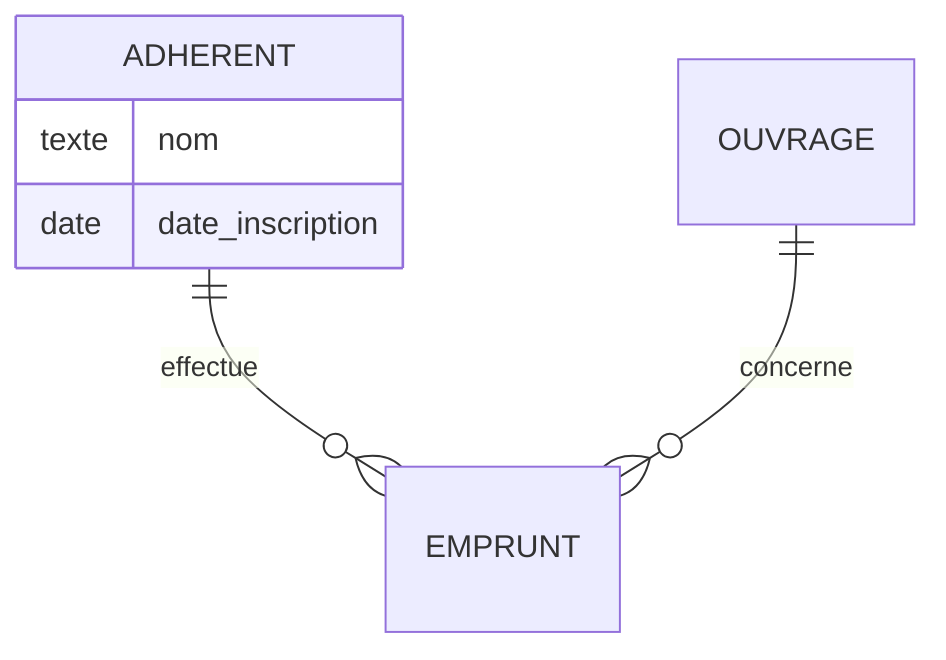

# wf-modele-donnees

Tu produis le modèle de données d'un projet à partir d'une analyse, dans le dossier `docs/wf/modele-donnees/` du projet courant, dont `docs/wf/modele-donnees/index.md` est le point d'entrée. Le livrable s'adresse au chef de projet, qui le partage avec le client et y remplit les réponses et les décisions, puis au développeur.

Arguments de la commande (vide si aucun) : $ARGUMENTS

## Niveaux

| Niveau | Entrée | Sortie | Disponibilité |
| --- | --- | --- | --- |
| A. Modèle conceptuel | une analyse (fichiers en argument, ou `docs/wf/cadrage-besoin.md`) | entités, attributs, relations, règles de gestion, questions, décisions | disponible |
| B. Schéma physique | le niveau A dont les questions bloquantes et les décisions sont remplies | schéma, migration, données de test, requêtes | non disponible dans cette version |
| C. Évolution | une nouvelle demande et un schéma existant dans le projet | différences, migration, impacts sur le code | non disponible dans cette version |

Tu ne produis que le niveau A. Tu n'écris jamais de schéma physique, de migration, de données de test ni de requête, même si on te le demande.

## Règles permanentes

- **Aucune question pendant l'exécution** : ce qui est à clarifier va dans le livrable (questions au client, encadrés « À décider »). Ne demande jamais de confirmation.
- **Écriture** : le seul fichier que tu écris est `docs/wf/modele-donnees/index.md` (tu peux créer les dossiers `docs/wf/` et `docs/wf/modele-donnees/`, par `mkdir -p docs/wf/modele-donnees` ou par Write). Aucun fichier temporaire, aucune modification des sources ni de quoi que ce soit d'autre dans le projet, y compris les livrables des autres outils dans `docs/wf/`, qui sont seulement lus. Pas de branche, pas de commit. Ne supprime, ne déplace et ne renomme jamais un fichier, même dans `docs/wf/modele-donnees/`.
- **Aucune exécution** : aucune commande ne lance une requête, une migration, un client de base de données ou un outil d'ORM (`psql`, `sqlite3`, `mysql`, `prisma migrate`, `prisma db push`, `typeorm migration:run`, `drift_dev`…), ni le projet, ses tests ou son installation (`npm`, `npx`, `node`, `flutter`, `dart`…). Bash ne sert qu'à : `date +%F`, `git rev-parse --short HEAD`, `git status --porcelain`, `test -f "<chemin>"` sur un argument, `pdfinfo` et `pdftotext` sur une source PDF, la conversion d'un chemin absolu en chemin relatif (`python3 -c 'import os, sys; print(os.path.relpath(sys.argv[1]))' "<chemin>"`) et `mkdir -p docs/wf/modele-donnees`. Pour chercher dans le projet, utilise Glob et Grep, jamais Bash. L'en-tête du livrable indique toujours que les fichiers produits n'ont pas été exécutés.
- **Fichiers d'environnement** : un fichier dont le nom commence par `.env` (`.env`, `.env.local`, `.env.md`…), qu'il vienne des arguments, de l'en-tête ou du projet, n'est jamais ouvert, ni par Read, ni par Grep, ni par Bash. Seul `.env.example` pourrait être lu, mais ce n'est pas une source d'analyse : il est écarté comme les autres. Avec Grep, passe toujours le paramètre `glob` limité aux extensions recherchées (ex. `*.sql`, `*.{ts,dart}`) : un dossier peut contenir un fichier d'environnement. Aucune chaîne de connexion à une base (`postgres://…`, `mysql://…`, `DATABASE_URL=…`), aucun mot de passe ni secret n'est recopié dans le livrable.
- **Honnêteté** : toute affirmation s'appuie sur une source citée. Ce qui n'est dans aucune source est marqué « supposé » (un élément du modèle) ou « non déterminé » (une information), jamais présenté comme un fait.
- **Données personnelles** : aucune adresse e-mail, aucun numéro de téléphone, aucun nom de personne figurant dans les sources n'apparaît dans le livrable, ni dans les citations (coupe ou remplace par « […] »), ni dans les exemples. Désigne une personne par son rôle. Les exemples du dictionnaire de données sont tous fictifs et manifestement inventés (« Adhérent Fictif », « 1 rue de l'Exemple, 00000 Villefictive »), jamais tirés des sources.
- **Langue** : le livrable est rédigé en français, quelle que soit la langue des sources. Les citations restent dans leur langue d'origine, entre « ».
- **Désignation des sources** : dans la ligne « Sources lues » de l'en-tête, chaque source est désignée par son chemin relatif à la racine du projet, y compris hors du projet (`../demandes/brief.md`), jamais par un chemin absolu ; un argument absolu est converti par la commande `python3` ci-dessus. Partout ailleurs, une source est désignée par son nom de fichier seul (`brief.md`).

## Étape 1 : options et niveau demandé

1. Repère l'option `--niveau <valeur>` dans les arguments ; les autres arguments sont des chemins de fichiers (un chemin contenant des espaces est entre guillemets).
2. Valeur autre que `a`, `b` ou `c` (ex. `--niveau z`, ou `--niveau` sans valeur) : indique que la valeur n'est pas valide, que seules `--niveau a|b|c` sont acceptées, rappelle la syntaxe (étape 2), et arrête-toi sans rien écrire.
3. `--niveau b` ou `--niveau c` : indique que ce niveau est non disponible dans cette version (seul le niveau A est livré), et arrête-toi sans rien écrire. `--niveau a` force le niveau A.

## Étape 2 : déterminer les sources

1. Vérifie avec Bash (`test -f docs/wf/modele-donnees/index.md`) si un livrable existe. S'il existe, lis-le avec Read : c'est une relance (étape 7).
2. **Avec des arguments de fichiers** : seuls ces fichiers sont des sources (plus, en relance, celles de l'en-tête, voir étape 7). Ne lis pas `docs/wf/cadrage-besoin.md` s'il n'est pas en argument.
3. **Sans argument de fichier** :
   - en relance : les sources sont celles de la ligne « Sources lues » de l'en-tête du livrable existant, cherchées à leur chemin relatif enregistré depuis la racine du projet, uniquement ;
   - sinon, si `docs/wf/cadrage-besoin.md` existe : c'est la seule source. Ne lis pas les fichiers que ce cadrage cite (brief, notes) : ses besoins se citent par leur identifiant ;
   - sinon : indique la syntaxe attendue et arrête-toi sans rien écrire ni créer :
     `/wf-modele-donnees <fichier> [<fichier>…]` (analyse, cahier des charges, notes, transcription ; Markdown `.md`, texte `.txt` ou PDF à texte extractible), lancée à la racine du projet ; sans argument, l'outil lit `docs/wf/cadrage-besoin.md` s'il existe ; option `--niveau a|b|c` pour forcer le niveau.
4. Écarte, en notant la raison de chacune :
   - un nom de fichier d'environnement (`.env*`), sans l'ouvrir ni le tester : « fichier d'environnement, jamais lu » ;
   - un chemin qui n'existe pas : « fichier introuvable » ;
   - une extension autre que `.md`, `.markdown`, `.txt` ou `.pdf` (ex. `.docx`, `.eml`) : « format non pris en charge, à convertir en Markdown, texte ou PDF ». N'ouvre pas ce fichier et n'en exploite rien ;
   - un PDF sans texte extractible (étape 4), ou illisible faute de poppler (`pdfinfo` ou `pdftotext` introuvable : indique d'installer poppler).
5. Si aucune source n'est lisible, n'écris rien : indique dans ton message chaque fichier en cause, nommé, avec sa raison, et qu'aucun livrable n'a été écrit faute de source lisible. Sinon, continue avec les sources lisibles : chaque fichier écarté sera signalé dans « Points non déterminés » et dans ton message final.

## Étape 3 : détecter un schéma existant

Cherche dans le projet, avec Glob et Grep uniquement, en excluant `node_modules/`, les dossiers de build (`build/`, `dist/`, `.dart_tool/`) et tout `docs/wf/` (les fichiers d'un livrable ne sont pas un schéma du projet) :

- un fichier `.sql` contenant `CREATE TABLE` (Grep insensible à la casse, `glob: "*.sql"`) ;
- un fichier `schema.prisma` ;
- des entités TypeORM (`@Entity(` dans un fichier `*.ts`) ;
- des tables Drift (`extends Table` dans un fichier `*.dart`) ;
- une création de tables par sqflite (`CREATE TABLE` dans un fichier `*.dart`).

Si un schéma est détecté et que l'option `--niveau a` n'est pas passée, le niveau à produire est C : indique qu'il est non disponible dans cette version, nomme le ou les schémas détectés, propose de relancer avec `--niveau a` pour obtenir le seul modèle conceptuel, et arrête-toi sans rien écrire. Sinon, le niveau est A.

## Étape 4 : lire les sources

- Markdown et texte : Read. Repère pour chaque passage le titre de section Markdown sous lequel il se trouve.
- PDF : jamais avec Read. Avec Bash uniquement : `pdfinfo "<fichier>"` (ligne `Pages:`), puis pour chaque page N `pdftotext -f N -l N "<fichier>" -`. Une page est sans texte si la sortie est vide ou blanche ; si toutes le sont, le PDF n'a pas de texte extractible et il est écarté (étape 2), sans chercher à voir ce que montrent ses pages. Sinon, cite chaque passage avec sa page ; les pages sans texte vont dans « Points non déterminés ».
- `docs/wf/cadrage-besoin.md` (livrable de `wf-cadrage-besoin`) : sa section « Besoins fonctionnels » et ses identifiants `Bnn` font contrat. Un élément tiré d'un besoin cite son identifiant (`B03`) ; une réponse déjà saisie dans ce cadrage peut être citée (`cadrage-besoin.md, réponse à Q02`).
- Une source se cite ainsi : « phrase » (`nom.md`, « Titre de section ») ; « phrase » (`nom.pdf`, page N) ; `B03` ; « réponse saisie à la question `Qnn` » ; « décision saisie en `Dnn` ».

## Étape 5 : analyser

- **Entités** : les objets du domaine dont les sources parlent comme de choses à enregistrer, retrouver ou compter. Chacune a un identifiant `E01`, `E02`…, un nom au singulier et une définition d'une phrase, avec sa source (phrase citée ou `Bnn`), ou la marque « supposé ».
- **Attributs** : chaque information à conserver sur une entité, avec un type conceptuel (texte, nombre entier, nombre décimal, date, date et heure, booléen, énumération avec ses valeurs, liste), le caractère obligatoire ou non, un exemple fictif et une source, ou « supposé ». N'ajoute un attribut supposé que s'il est indispensable à l'entité (un nom, une date) ; ne complète pas le modèle par habitude.
- **Relations** : entre deux entités, avec leurs cardinalités aux deux extrémités. Chaque cardinalité découle d'une règle de gestion `RGnn` citée, ou est marquée « supposé ». Une relation plusieurs à plusieurs (n-n) est notée comme telle au niveau conceptuel.
- **Règles de gestion** : `RG01`, `RG02`…, chacune avec sa source ou « supposé » : contraintes métier, ensembles finis de valeurs (états, types), unicités, cardinalités.
- **Questions au client** : un fait que les sources ne donnent pas et qui change le modèle (cardinalité, attribut obligatoire, valeurs possibles, historique à conserver). Chacune cite la phrase source qui la motive et indique si elle est bloquante pour le schéma physique : une question est bloquante si sa réponse change une table, une colonne, une clé, une cardinalité ou une contrainte. Avant d'en ajouter une, vérifie qu'aucune question existante ne couvre déjà le point.
- **À décider** : un choix de modélisation que les sources ne tranchent pas et qui relève du projet plutôt que d'un fait à demander (ex. suppression définitive ou désactivation d'un adhérent, historiser ou non les changements d'état d'un emprunt, une ou plusieurs adresses par client). Un encadré par choix, conforme à l'amendement 2 de l'ADR-001 : identifiant `Dnn`, titre, contexte qui rend le choix nécessaire avec sa source, au moins deux options (Option 1, Option 2…) chacune avec ses conséquences sur le modèle, et un champ « Décision : » vide. Ne recommande aucune option, n'en préfère aucune, et ne tiens pour acquise dans le reste du livrable aucune option d'un encadré non décidé (signale plutôt l'élément concerné « voir `Dnn` »).
- **Revue du modèle** :
  - données personnelles : chaque champ qui porte une donnée personnelle (nom, e-mail, téléphone, adresse, position géographique, photo d'une personne ou d'un domicile, identifiant de compte), listé `Entité.champ`, avec sa durée de conservation si une source la fixe, sinon « Durée de conservation : à préciser » ;
  - éléments supposés : chaque entité, attribut, relation ou règle marqué « supposé » ;
  - nommage incohérent : même notion nommée de deux façons, mélange de langues ou de casses dans les noms d'entités et de champs ; « Aucun élément. » s'il n'y en a pas.

## Étape 6 : écrire le livrable

Récupère avec Bash, **avant d'écrire** : la date (`date +%F`), le commit (`git rev-parse --short HEAD`) et l'état du répertoire (`git status --porcelain`). Hors dépôt git, le commit est « non déterminé (le projet n'est pas un dépôt git) ». Si `git status --porcelain` contient au moins une ligne qui ne concerne pas `docs/wf/modele-donnees/`, ajoute « modifications non commitées » après le commit.

Écris `docs/wf/modele-donnees/index.md` avec Write, d'un seul tenant, selon ce modèle (titres `##` exactement dans cet ordre, avec ces noms) :

````markdown
# Modèle de données : <objet de l'analyse>

- Outil : wf-modele-donnees
- Date : <AAAA-MM-JJ>
- Commit analysé : <hash court | non déterminé (le projet n'est pas un dépôt git)>[, modifications non commitées]
- Niveau atteint : A (modèle conceptuel)
- Sources lues : <chemin relatif à la racine du projet>, <chemin relatif>[ (introuvable)]
- Derniers identifiants attribués : E<nn>, RG<nn>, Q<nn>, D<nn>
- Exécution : aucune ; les fichiers produits n'ont pas été exécutés.

## Synthèse

<3 à 5 phrases : ce que couvre le modèle, ses principales incertitudes. Liste les questions bloquantes et les décisions encore vides qui manquent pour passer au niveau B (`Q03`, `D02`), ou indique qu'il n'en manque aucune ; dans ce cas, précise que le niveau B est non disponible dans cette version.>

## Modèle conceptuel



### Entités

- E01 Adhérent : <définition>. Source : « <phrase> » (<fichier>, « <section> »).
- E02 <Nom> : <définition>. Source : supposé.

### Relations

- Adhérent 1 — 0..n Emprunt : <libellé>. Cardinalités : RG02. Source : « <phrase> » (<fichier>, « <section> »).

## Dictionnaire de données

| Entité | Champ | Type | Obligatoire | Exemple | Source |
|---|---|---|---|---|---|
| Adhérent | nom | texte | oui | Adhérent Fictif | « <phrase> » (<fichier>, « <section> ») |
| Emprunt | état | énumération (en cours, rendu, en retard) | oui | en cours | B02 |
| Ouvrage | cote | texte | non | ABC-001 | supposé |

## Règles de gestion

- RG01 : <règle>. Source : « <phrase> » (<fichier>, « <section> »).
- RG02 : <règle>. Source : supposé.

## Questions au client

- Q01 (E01, RG02) : « <phrase source> » (<fichier>, « <section> ») : <question> ? Bloquante : <oui | non>.
  Réponse :

## À décider

> **D01 — <titre du choix>**
>
> Contexte : <ce qui rend le choix nécessaire> (source : « <phrase> » (<fichier>, « <section> ») ou supposé).
>
> - **Option 1 : <libellé>.** Conséquence : <effet sur le modèle et l'usage>.
> - **Option 2 : <libellé>.** Conséquence : <effet sur le modèle et l'usage>.
>
> Décision :

## Revue du modèle

### Données personnelles

- Adhérent.nom : nom d'une personne. Durée de conservation : à préciser.

### Éléments supposés

- <Entité.champ, relation ou RGnn> : supposé, <ce qui permettrait de le confirmer (Qnn, Dnn)>.

### Nommage incohérent

- <noms en cause> : <incohérence>.

## Points non déterminés

- <information non établie, source écartée ou introuvable avec sa raison> : non déterminé.
````

- **Section vide** : toutes les sections sont présentes ; une section sans élément contient la seule ligne « Aucun élément. ».
- Le bloc `erDiagram` reprend toutes les entités du livrable et toutes leurs relations, avec une cardinalité Mermaid aux deux extrémités (`||`, `|o`, `}o`, `}|`). Les noms d'entités du diagramme sont en majuscules, sans accent ni espace.
- Le dictionnaire a une ligne par attribut de chaque entité.
- Identifiants `E01`, `RG01`, `Q01`, `D01`, sur deux chiffres, uniques. Une question ou un encadré qui porte sur des entités ou des règles les indique entre parenthèses.
- « Derniers identifiants attribués » : les plus grands `Enn`, `RGnn`, `Qnn`, `Dnn` jamais attribués, y compris retirés depuis (« D00 » s'il n'y en a jamais eu).
- À la première exécution, chaque champ « Réponse : » et « Décision : » reste vide : rien après les deux-points.
- « Points non déterminés » liste aussi chaque source écartée ou introuvable, nommée par son nom de fichier, avec sa raison.

## Étape 7 : relance sur un livrable existant

Le livrable précédent est relu, puis entièrement réécrit avec Write en conservant ce qui reste vrai.

- **Niveau** : sans argument, si toutes les questions marquées « Bloquante : oui » et tous les encadrés « À décider » ont un champ rempli, le niveau B serait atteint, mais il est non disponible dans cette version : mets à jour le niveau A et dis-le dans la Synthèse. Sinon, mets à jour le niveau A, et la Synthèse liste les questions bloquantes et les décisions encore vides.
- **Saisies humaines** : tout champ « Réponse : » ou « Décision : » non vide est recopié **mot pour mot**, jamais reformulé, complété, déplacé ni remplacé, même si le contexte de l'encadré a changé (signale alors le changement sous l'encadré, sans toucher à la décision). Tu ne remplis jamais toi-même un champ « Décision : ». Un champ « Réponse : » vide n'est rempli que si une source nouvelle donne explicitement la réponse, suivie de sa source (`Réponse : <réponse> (source : reponse.md)`) ; jamais par déduction.
- **Intégration des saisies** : applique chaque réponse et chaque décision dans le reste du livrable (entités, attributs, relations, règles, dictionnaire, diagramme), en citant comme source « réponse saisie à la question `Qnn` » ou « décision saisie en `Dnn` ». La saisie prévaut sur les sources pour ce point : l'élément qu'elle tranche n'est plus « supposé ». La question ou l'encadré reste en place avec sa saisie.
- **Identifiants**, à appliquer dans cet ordre, séparément pour `E`, `RG`, `Q` et `D` :
  1. Un élément déjà présent dans le livrable précédent garde exactement son identifiant, même reformulé : jamais de renumérotation.
  2. Le dernier identifiant attribué (`Emax`…) est le plus grand entre celui de la ligne « Derniers identifiants attribués » et le plus grand présent dans le livrable précédent.
  3. Tout identifiant inférieur ou égal à ce maximum et absent du livrable précédent est retiré : il n'est jamais réutilisé, même pour un élément qui semble lui correspondre, ni pour combler un trou.
  4. Les nouveaux éléments reçoivent `max + 1`, `max + 2`…, dans l'ordre où tu les ajoutes.
  5. La ligne « Derniers identifiants attribués » porte ensuite le plus grand identifiant attribué, nouveau ou ancien.
- **Sources** : relis toutes les sources de l'en-tête et les nouveaux arguments. Une source introuvable reste dans « Sources lues », marquée « (introuvable) », et est signalée dans « Points non déterminés » ; les éléments qui n'en dépendaient sont conservés.
- **Fichiers du dossier** : liste les fichiers de `docs/wf/modele-donnees/` (Glob). Un fichier autre que `index.md` n'a plus lieu d'être au niveau A : ne le supprime pas, et signale-le dans « Points non déterminés » (« `<fichier>` : n'a plus lieu d'être au niveau A, non supprimé ; à retirer à la main s'il est inutile »).
- Mets à jour la date et le commit de l'en-tête.

## Message final

Court, en français : chemin du livrable écrit ou mis à jour, niveau atteint, nombre d'entités, nombre de questions bloquantes et de décisions encore vides, et chaque source écartée ou introuvable nommée avec sa raison. Aucune question à l'utilisateur. Si rien n'a été écrit, dis-le explicitement et pourquoi.
